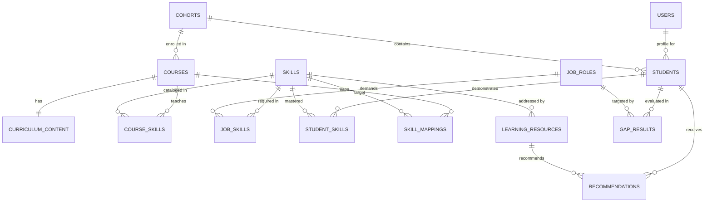

# Software Requirements Specification (SRS)
## Academia–Industry Skill Mapping and Placement Portal
**Smart India Hackathon 2026 · Group G29**

---

### Team Details
- **Shivam Chandel** — Roll No.: RK3P25ORA20 | Reg. No.: 12522547
- **Nayneet Kumar** — Roll No.: RK3P25ORB37 | Reg. No.: 12518540
- **Group No.:** G29
- **Problem Statement ID:** SIH26044 (*Portal for Academia–Industry Collaboration for Skill Mapping, Internships and Placement*)
- **Target Organization:** Ministry of Ayush / SIH 2026

---

## Problem Statement
Students cannot easily identify the skills required for their target job roles, while employers struggle to find candidates who possess those skills.

## Project Goal
Develop a portal that maps academic curricula to industry job requirements, identifies skill gaps for student cohorts, and provides actionable placement-readiness insights.

---

## 1. Introduction

### 1.1 Purpose
The purpose of this SRS document is to define the functional and non-functional requirements, system architecture, modules, interfaces, database structure, and expected behavior of the **Academia–Industry Skill Mapping and Placement Portal**. The document will guide developers, testers, project evaluators, and report-generation tools in understanding and implementing the system.

### 1.2 Scope
The proposed system is a web-based platform that connects academic learning with industry expectations. It helps students understand the skills required for specific job roles and helps academic institutions identify gaps between their curriculum and industry requirements.

The portal provides:
- Academic curriculum and subject skill extraction.
- Industry job description and skill requirement extraction.
- Mapping between academic subjects and industry skills.
- Student skill-gap analysis and placement-readiness assessment.
- Recommendations for courses, certifications, and learning resources.
- Cohort-level reports and interactive dashboards.
- Administrative management of academic and industry data.

### 1.3 Intended Users
| User | Responsibilities |
| :--- | :--- |
| **Students** | View skill gaps, target roles, and learning recommendations. |
| **Faculty members** | Review curriculum mappings and monitor student readiness. |
| **Placement officers** | Analyze placement readiness and identify suitable candidates. |
| **Administrators** | Manage users, academic data, job roles, and system settings. |
| **Employers / Industry partners** | Provide job descriptions and required skill profiles. |

### 1.4 Definitions and Abbreviations
- **SRS:** Software Requirements Specification
- **AI:** Artificial Intelligence
- **NLP:** Natural Language Processing
- **ATS:** Applicant Tracking System
- **Skill Gap:** Difference between the skills a job requires and those demonstrated or taught.
- **Skill Mapping:** Connecting curriculum topics and learning outcomes to industry-required skills.
- **Cohort:** A group of students analyzed together, such as a class, section, or graduating batch.
- **F1 Score:** A classification evaluation metric combining precision and recall.
- **Mapping Precision:** The proportion of predicted skill mappings that are correct.

---

## 2. Overall Description

### 2.1 Product Perspective
The portal functions as a centralized web application with a frontend interface, backend REST API, database, and skill extraction & matching engine. It combines academic information with industry job descriptions to generate meaningful skill-mapping and placement-readiness reports.

### 2.2 Product Functions
1. User registration, login, and role-based access control (RBAC).
2. Uploading or entering academic curriculum information.
3. Uploading or entering industry job descriptions.
4. Extracting technical and professional skills from unstructured text.
5. Mapping academic learning outcomes to industry skills.
6. Calculating skill gaps and coverage percentages (both unweighted and weighted).
7. Recommending relevant courses and learning resources tied to identified gaps.
8. Generating student, cohort, and placement dashboards.
9. Producing downloadable reports (PDF, CSV).
10. Evaluating extraction and mapping quality using precision, recall, F1, and baseline comparisons.

### 2.3 Operating Environment
- **Frontend:** Modern web browser on desktop, tablet, or mobile.
- **Backend:** REST API server (Python FastAPI).
- **Database:** Relational database (PostgreSQL / SQLite for development).
- **Skill Processing:** Python-based NLP and text-processing services.
- **Development Environment:** Visual Studio Code or similar IDE.
- **Deployment:** Cloud hosting or institutional server.

### 2.4 Assumptions and Dependencies
- Academic curricula, course descriptions, and learning outcomes are available for analysis.
- Job descriptions can be entered manually or uploaded in supported formats (PDF, DOCX, TXT).
- Publicly available job descriptions and learning resources can be used for benchmarking.
- AI-generated mappings are treated as recommendations subject to authorized human review.
- Quality of results depends on the completeness and accuracy of input data.
- Student-specific readiness scores are only generated when appropriate student skill evidence is available.

---

## 3. Specific Requirements

### 3.1 Functional Requirements

- **FR-01: User Authentication and Authorization**
  - Secure login with role-based access for Students, Faculty, Placement Officers, Industry Partners, and Admins.
  - Granular permissions preventing unauthorized data access.
  - Password hashing and secure token-based sessions.

- **FR-02: Academic Curriculum Management**
  - Upload course syllabi, descriptions, and learning outcomes (PDF/DOCX/Text).
  - Extract technical skills, concepts, tools, and technologies.
  - Review, correct, and approve extracted skills.
  - Associate academic data with courses, departments, semesters, and cohorts.

- **FR-03: Industry Job Requirement Management**
  - Add or upload job descriptions (PDF/DOCX/Text).
  - Extract required skills, tools, qualifications, and experience levels.
  - Categorize by job role, domain, and industry.
  - Review and validate extracted requirements.

- **FR-04: Academia–Industry Skill Mapping**
  - Compare academic skills with industry job requirements.
  - Identify exact matches, related (semantic) matches, and unmet requirements.
  - Associate mappings with source traces and confidence scores.
  - Enable authorized review, approval, or modification of mappings.
  - Compute curriculum coverage percentages.

- **FR-05: Skill-Gap Analysis**
  - Select target job role.
  - Compare required skill profile with student skill evidence.
  - Categorize skills as demonstrated, partially demonstrated, or missing.
  - Compute skill-gap and coverage percentages.
  - Provide cohort-level aggregates for faculty and placement officers.

- **FR-06: Learning Recommendations**
  - Recommend courses, certifications, and resources linked to identified skill gaps.
  - Rank recommendations by relevance to target role and gap magnitude.
  - Explicitly explain which gap each resource addresses.
  - Provide verified resource links.

- **FR-07: Dashboards and Reporting**
  - **Student Dashboard:** Target roles, skill coverage, missing skills, learning paths.
  - **Faculty Dashboard:** Curriculum coverage, syllabus gaps requiring greater academic emphasis.
  - **Placement Dashboard:** Cohort readiness indicators, aggregate skill shortages.
  - Exportable reports in CSV and PDF formats.

- **FR-08: Administration and Data Management**
  - Manage users, roles, courses, job profiles, and taxonomy.
  - Validate uploads and handle processing exceptions cleanly.
  - Audit logs for administrative actions.

- **FR-09: Model Evaluation**
  - Precision, Recall, and F1 score against a manually verified ground-truth dataset.
  - Mapping precision and gap-coverage measurements.
  - Comparative benchmark against a keyword-matching baseline.
  - Inspection interface for evaluation errors.

### 3.2 Non-Functional Requirements
- **NFR-01 (Performance):** Dashboard and search queries respond within 3 seconds under typical load.
- **NFR-02 (Security):** Password hashing (bcrypt/argon2), JWT tokens, SQL injection protection via ORM, input validation.
- **NFR-03 (Usability):** Intuitive, responsive interface with clear visualizations (radar charts, coverage bars).
- **NFR-04 (Reliability):** Graceful file handling without corrupting existing databases.
- **NFR-05 (Scalability):** Modular architecture allowing independent scaling of NLP services and API.
- **NFR-06 (Maintainability):** Clean separation of concerns (Frontend, Backend REST API, NLP Engine, Database).
- **NFR-07 (Compatibility):** Support for modern evergreen desktop and mobile browsers.
- **NFR-08 (Data Privacy):** Anonymized cohort metrics; student private data isolated per RBAC.
- **NFR-09 (Accuracy):** Transparent reporting of empirical metrics on labeled benchmark sets.
- **NFR-10 (Accessibility):** High-contrast color palettes and accessible UI components.

---

## 4. System Architecture

```
+-------------------------------------------------------------------------+
|                           PRESENTATION LAYER                            |
|    React.js + Tailwind CSS UI / Interactive Dashboards / Visualizations  |
|      [Student Portal] [Faculty Portal] [Placement Portal] [Admin]       |
+------------------------------------+------------------------------------+
                                     |  REST APIs (JSON / JWT)
+------------------------------------v------------------------------------+
|                           APPLICATION LAYER                             |
|               FastAPI (Python) REST Service & Business Logic            |
|  [Auth/RBAC] [Curriculum Mgmt] [Job Mgmt] [Gap Analyzer] [Reports]      |
+------------------+----------------------------------+-------------------+
                   |                                  |
+------------------v---------------+  +---------------v-------------------+
|      SKILL INTELLIGENCE LAYER    |  |            DATA LAYER             |
|   NLP Extraction (spaCy / Regex) |  |   Relational DB (PostgreSQL)      |
|   Canonical Skill Normalization  |  |   - Users, Roles & Cohorts        |
|   Semantic Similarity Embeddings |  |   - Courses & Curriculum Content  |
|   Recommendation Ranker          |  |   - Job Roles & Required Skills   |
|   Model Evaluator (Precision/F1) |  |   - Mappings, Gaps & Resources    |
+----------------------------------+  +-----------------------------------+
```

---

## 5. Database Schema (Entity Relationships)



---

## 6. Skill Mapping & Gap Analysis Mathematical Formulas

### 6.1 Basic Unweighted Skill Coverage
$$\text{Coverage (\%)} = \frac{\text{Number of required skills covered}}{\text{Total number of required skills}} \times 100$$
$$\text{Gap (\%)} = 100 - \text{Coverage (\%)}$$

### 6.2 Weighted Skill Coverage
$$\text{Coverage (\%)} = \frac{\sum_{i=1}^{n} w_i \cdot c_i}{\sum_{i=1}^{n} w_i} \times 100$$
Where:
- $w_i \in [1, 5]$ is the importance weight of required skill $i$ (e.g., 5 = Core Requirement, 1 = Nice to have).
- $c_i \in \{0.0, 0.5, 1.0\}$ represents the coverage state:
  - $1.0$: Fully demonstrated / covered
  - $0.5$: Partially covered
  - $0.0$: Missing / uncovered
- $n$ is the total count of required skills for the role.

### 6.3 Evaluation Metrics
$$\text{Precision} = \frac{TP}{TP + FP}, \quad \text{Recall} = \frac{TP}{TP + FN}, \quad F_1 = 2 \cdot \frac{\text{Precision} \cdot \text{Recall}}{\text{Precision} + \text{Recall}}$$

---

## 7. Deliverables Checklist
- [x] Comprehensive Software Requirements Specification document (`docs/SRS.md`)
- [ ] Relational Database Models & Initial Migration
- [ ] Fast & Lightweight Skill Extraction and Normalization Engine
- [ ] REST API Endpoints for Curriculum, Jobs, Mappings, and Gap Analysis
- [ ] Role-Based Dashboards (Student, Faculty, Placement, Admin)
- [ ] Benchmark Evaluation Dataset & Baseline Comparator
- [ ] Automated Tests (TC-01 through TC-12)
