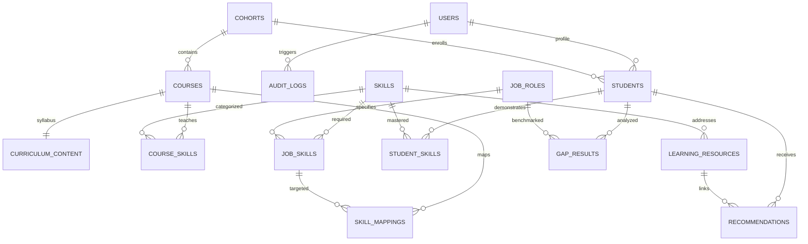
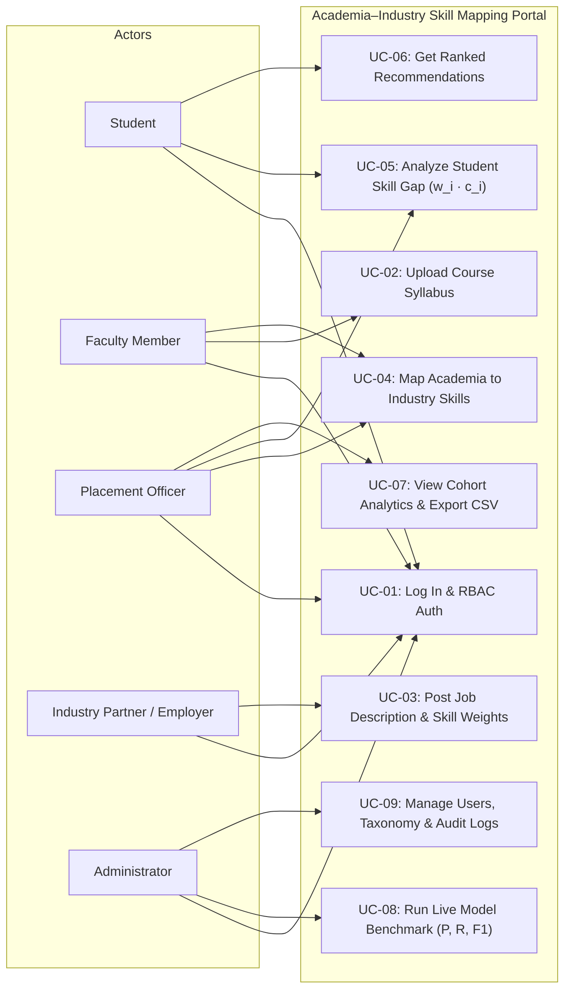
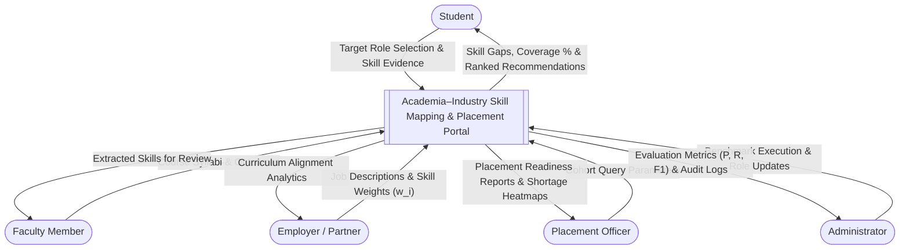
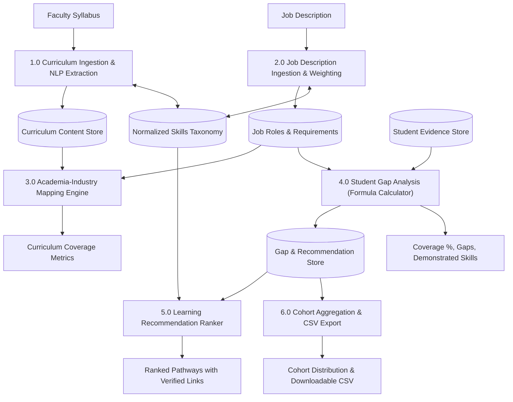
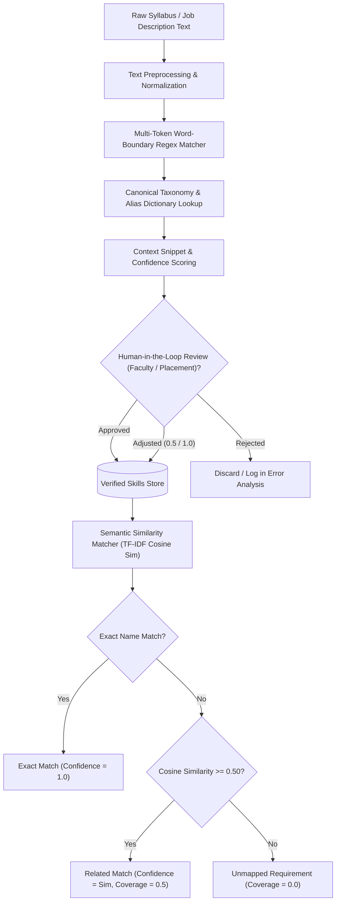
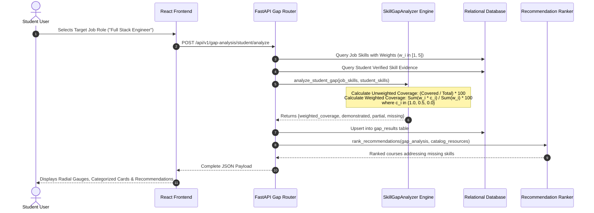

# Academia–Industry Skill Mapping & Placement Portal
## System Architecture & Technical Diagrams
**Smart India Hackathon 2026 · Group G29**
- **Problem Statement ID:** SIH26044
- **Team Members:** Shivam Chandel (12522547) & Nayneet Kumar (12518540)

---

## 1. 4-Tier System Architecture Diagram

```
+----------------------------------------------------------------------------------------------------+
|                                         PRESENTATION LAYER                                         |
|                                    React 18 + Tailwind CSS + Vite                                  |
|  +--------------------+  +--------------------+  +---------------------+  +----------------------+ |
|  | Student Dashboard  |  | Faculty Dashboard  |  | Placement Dashboard |  | Employer / Partner   | |
|  | - Role Selection   |  | - Syllabus Upload  |  | - Readiness Tiers   |  | - JD Upload & Weight | |
|  | - Gap Gauges (w_i) |  | - Extraction Audit |  | - Shortage Heatmap  |  | - Skill Requirements| |
|  | - Ranked Pathways  |  | - Curriculum Matrix|  | - CSV/PDF Export    |  |                      | |
|  +--------------------+  +--------------------+  +---------------------+  +----------------------+ |
|  +--------------------------------------------+  +-----------------------------------------------+ |
|  | Skill-Mapping Workspace                    |  | Model Evaluation Lab & Admin Governance       | |
|  | - Dual-Pane Curriculum vs Industry Compare  |  | - Precision/Recall/F1 vs Baseline Comparator  | |
|  | - Exact & Semantic Match Linkages          |  | - Inspectable Error Samples & Audit Trail     | |
|  +--------------------------------------------+  +-----------------------------------------------+ |
+-------------------------------------------------+--------------------------------------------------+
                                                  | JSON / JWT REST APIs (HTTP / HTTPS)
+-------------------------------------------------v--------------------------------------------------+
|                                          APPLICATION LAYER                                         |
|                               Python FastAPI (REST API Service & Routers)                          |
|  +--------------------+  +--------------------+  +---------------------+  +----------------------+ |
|  | /api/v1/auth       |  | /api/v1/curriculum |  | /api/v1/jobs        |  | /api/v1/mapping      | |
|  | - JWT Tokens / RBAC|  | - Syllabi Ingestion|  | - JD Parser & Weight|  | - Exact & Semantic   | |
|  | - Password Hashing |  | - Course Registry  |  | - Experience Levels |  | - Coverage Stats     | |
|  +--------------------+  +--------------------+  +---------------------+  +----------------------+ |
|  +--------------------+  +--------------------+  +---------------------+  +----------------------+ |
|  | /api/v1/gap-analysis|  | /recommendations   |  | /api/v1/analytics   |  | /evaluation & admin  | |
|  | - Weighted Coverage|  | - Gap-Targeted Rank|  | - Cohort Aggregation|  | - Benchmark Runner   | |
|  | - Demonstrated Evi |  | - Resource Catalog |  | - Streaming CSV Exp |  | - Audit Log Store    | |
|  +--------------------+  +--------------------+  +---------------------+  +----------------------+ |
+------------------------+---------------------------------+-----------------------------------------+
                         |                                 |
+------------------------v---------------+  +--------------v-----------------------------------------+
|        SKILL INTELLIGENCE LAYER        |  |                       DATA LAYER                       |
|  - Text Preprocessing & Cleaning       |  | Relational Database (PostgreSQL / SQLite Engine)       |
|  - Word Boundary Regex & Token Matcher |  |  1. users               9. job_skills                  |
|  - Canonical Taxonomy Normalization    |  |  2. students           10. student_skills              |
|  - TF-IDF Vector & Cosine Similarity   |  |  3. cohorts            11. skill_mappings              |
|  - Weighted Scoring Engine (wi · ci)   |  |  4. courses            12. learning_resources          |
|  - Empirical Benchmark Suite (P, R, F1)|  |  5. curriculum_content 13. recommendations             |
|  - Naive Keyword Baseline Comparator   |  |  6. skills             14. gap_results                 |
|                                        |  |  7. course_skills      15. evaluation_records          |
|                                        |  |  8. job_roles          16. audit_logs                  |
+----------------------------------------+  +--------------------------------------------------------+
```

---

## 2. Entity-Relationship (ER) Diagram



---

## 3. Use Case Diagram



---

## 4. Data Flow Diagrams (DFD)

### DFD Level 0: Context Diagram



### DFD Level 1: System Decomposition



---

## 5. Skill Extraction & Semantic Mapping Flowchart



---

## 6. Student Skill-Gap Analysis Sequence Diagram


